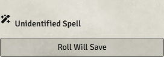
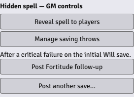
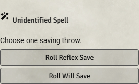
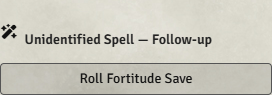

# PF2e Hidden Enemy Spells

[](https://github.com/jjthibau/pf2e-hidden-enemy-spells/releases/latest)
[](https://github.com/jjthibau/pf2e-hidden-enemy-spells/actions/workflows/ci.yml)
[](LICENSE)


**Cast the enemy's spell. Ask for the save. Reveal it when the party recognizes it.**

A free Foundry VTT module for Pathfinder Second Edition. The GM casts normally from an enemy NPC sheet; players initially see **Unidentified Spell** and PF2e's native saving throw buttons. The full spell stays on the GM's private card, with a **Reveal spell to players** button.



## What it does

- Hides spell names, artwork and descriptions on the initial player card.
- Uses native **Roll Will Save**, Reflex and Fortitude buttons with PF2e's normal roll dialogs and save mechanics.
- Follows the GM's PF2e DC visibility settings; native rolls retain existing result and breakdown visibility.
- Prompts the GM for caster-selected alternatives and shows alternatives when the target chooses.
- Keeps conditional follow-up saves with the GM until they are actually needed.
- Reveals the full native spell on the same chat card.
- Recognize Spell button checks the selected character's prepared spells/repertoire before rolling, then uses native skills and the GM's visibility settings.
- The button names the required skill, for example **Recognize Spell (Arcana)**. Unknown spells automatically fail recognition if the character is untrained in the resolved skill; supported feat substitutions still apply. Repeat attempts are allowed; the table handles action costs and retry rulings.
- Optional automatic party recognition on casting, default off, with individual token sight and consciousness checks.
- Optional **Reveal spell after successful recognition**, default off, reveals the card on a successful check and names the recognizing PC.
- Preserves native spell-slot consumption. Cancelling a caster-choice dialog does not spend a slot.
- Leaves player-character spells, party-allied NPC spells and explicitly private casts in their normal visibility scope.

No other add-on modules are required.

## Install

1. In Foundry's Setup screen, open **Add-on Modules → Install Module**.
2. Paste this **Manifest URL** and click **Install**:

```text
https://github.com/jjthibau/pf2e-hidden-enemy-spells/releases/latest/download/module.json
```

3. Launch your PF2e world and enable **PF2e Hidden Enemy Spells** under **Manage Modules**.
4. Have the GM and players reload after changing the enabled module list.

**Verified:** Foundry VTT **14.369**, PF2e **8.6.0**. This release requires Foundry14.369+ within generation14 and PF2e8.6.0+. Later PF2e versions have not yet been verified. UI text is currently English.

The manifest URL works independently of Foundry's package directory. Directory listing requires a separate submission and approval; see [publishing](docs/publishing.md).

## At the table

1. **GM:** cast from an unowned NPC's spellcasting entry.
2. **Players:** select their affected tokens and click the anonymous saving throw button. If the spell lets each target choose, choose one of the displayed saves.
3. **GM:** keep the private full card for normal spell controls. Its attack, damage and template buttons use anonymous labels while the spell is hidden.
4. **GM:** use a labeled follow-up button only after an outcome or timing condition calls for that save.
5. **GM:** click **Reveal spell to players** when the spell is recognized.

### Recognizing a spell

Select one character you own and click **Recognize Spell** on an unidentified card. With no selected character token, the button uses your assigned character. A connected GM resolves the request. Action/reaction costs are handled by the table.

Repeat attempts are allowed on the same card. **Reveal spell after successful recognition** is a separate world setting, default **off**. Enable it to reveal the card after a success or critical success and show which PC recognized it. Failed attempts leave it unidentified. With this setting off, the GM chooses when to reveal rolled recognitions.

If the character has that spell prepared today (including an expended preparation) or in their spontaneous repertoire, the card reveals immediately without a roll. A note on the revealed card names the recognizing PC and explains whether the spell was prepared or in their repertoire; the note persists after reload. This does not require matching traditions, and works even with automatic party recognition disabled. A spell merely stored in a spellbook, an innate spell, or a focus spell does not by itself qualify as prepared/in repertoire.

Otherwise, the button uses the skill for the actual casting tradition: Arcana, Religion, Occultism or Nature. Unified Theory can substitute Arcana. The DC uses the cast rank's standard spell DC plus rarity (+2 uncommon, +5 rare, +10 unique) and the caster's Bizarre Magic adjustment (+5); this is separate from the caster's save DC. The private GM card has a **Recognition DC override** control; leave it blank to restore automatic calculation. Characters without Recognize Spell use Recall Knowledge. Native secret-check, DC, result and breakdown visibility settings apply. A GM receives the identification outcome and retains the Reveal control for rolled checks, including choosing misinformation on critical failure. Critical-success AC/save bonuses remain table-managed.

Recognize Spell's common-spell proficiency thresholds are handled in the native roll. Unknown-spell attempts with an untrained resolved skill automatically fail without rolling; prepared/repertoire matches are checked first. Oddity Identification can select Occultism for qualifying Recall Knowledge checks, with its native bonus; it is not treated as permission to substitute Occultism for the Recognize Spell reaction. Other feat/homebrew exceptions remain GM-adjudicated.

**Automatically reveal spells recognized by the party** is a world setting, default **off**. When enabled, casting checks party characters on the caster's currently rendered scene, regardless of whether their players are online. With no configured party members, party-allied player-owned characters are considered. A matching prepared/repertoire spell and confirmed individual sight are required. Walls, illumination and native sight range are checked without controlling tokens or using shared/GM vision. Unconscious, dead, blinded or GM-hidden observers, hidden/invisible casters and subtle spells do not trigger automatic reveal. Deafness and paralysis alone do not prevent visual recognition. No arbitrary distance limit is added.

Missing caster tokens, an unrendered scene, unsupported sight machinery, hearing-only awareness, special senses and concealed casting that is not represented in the spell's traits require GM adjudication. Automatic recognition leaves these uncertain cases unidentified. Manual button clicks leave awareness to the table.

**Manage saving throws** lets the GM correct the current cast's initial/later saves, explicit DCs, and choice rules. **Post another save…** handles repeats and unusual instructions, with optional incapacitation.



### Multiple saves and choices

| Spell | Initial prompt | Later / choice behavior |
| --- | --- | --- |
| Phantasmal Killer, legacy | Will | GM posts Fortitude with incapacitation after the relevant critical failure. |
| Phantasmal Calamity | Basic Will | GM releases conditional Reflex and later Will checks. |
| Shadow Raid | Reflex or Will | Each target chooses one. |
| Cinder Swarm | GM-selected Reflex or Fortitude | Selects the matching native Ants/Fireflies variant. |
| Wrathful Storm | GM-selected effect | Includes effects with no save. |
| Vision of Death | Will | Does not inherit legacy Phantasmal Killer's follow-up. |

Other spells use their native primary save. Additional explicit inline save checks open a GM review dialog so the GM can decide sequencing and who chooses.

<details>
<summary>See target-choice and follow-up prompts</summary>

| Target chooses a save | GM releases a later save |
| --- | --- |
|  |  |

</details>

### Settings

**Configure Settings → PF2e Hidden Enemy Spells → Hide enemy spell cards** enables or disables concealment for new casts. Existing hidden cards retain their GM controls.

The module uses PF2e's existing **Show DC** setting. Restrictive settings show **Roll Will Save**; permissive settings may show the DC as well. Use Foundry's normal message mode for an explicitly GM-only or blind cast.

## Limitations

- The GM adjudicates conditions, affected creatures and repeat timing. This is not a rules engine for every spell's prose.
- Skill alternatives such as Grease's Acrobatics check remain manual.
- Use this module's follow-up controls to post concealed saves. Reposting an original spell's inline links, arbitrary macros, or another module's custom chat output can reveal identifying information.
- Anonymous attack/damage copies use a generic name and slug. Custom rules keyed to a particular spell slug need review.
- Concealment follows Foundry's existing GM-whisper/document-permission model. Mechanically necessary traits, caster context and cast rank remain available for native saves.
- Other modules that replace casting/chat behavior can conflict. Include your module list when reporting a problem.

## Development and support

[Report a bug or request spell support](https://github.com/jjthibau/pf2e-hidden-enemy-spells/issues/new/choose) · [Changelog](CHANGELOG.md) · [Contributing](CONTRIBUTING.md) · [Architecture](docs/architecture.md) · [Testing](docs/testing.md)

Requires Node.js22+ and Python3.10+ for development. No npm dependencies:

```sh
npm test
npm run build
npm run check:release
```

Portable tests run in CI. Native acceptance testing uses separate GM/player clients in an isolated licensed Foundry world; see the test guide for coverage and practical limits.

## License and credits

Code is [MIT licensed](LICENSE). Foundry VTT and the PF2e system are separate projects; this is an unofficial community module and is not endorsed by Foundry Gaming or Paizo. No Foundry software, spell compendium, adventure content or campaign data is distributed.

Screenshots show the real UI in a synthetic test world. Software development and documentation used AI assistance under maintainer direction; the module does not call an AI service at runtime.
