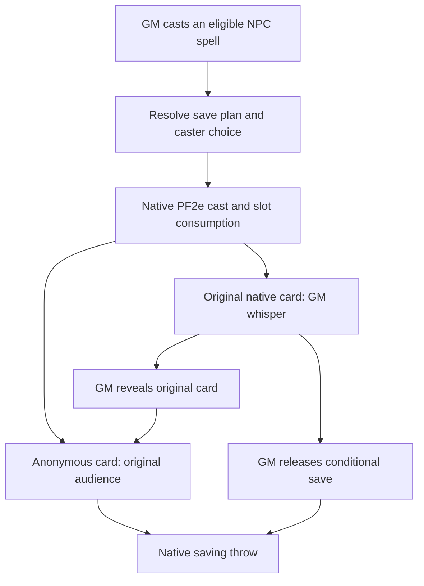

# Architecture and maintenance

The module extends native spell casting and chat; it does not edit actors, owned spell documents, spell slots, conditions or HP directly. `scripts/main.js` is the Foundry integration. `scripts/plans.js` is a pure save-sequencing planner.

## One cast, two views

The `spellcastingEntry.cast` wrapper resolves choices before calling PF2e's original method. A cancelled choice returns before the original method can consume anything. A per-spell in-flight guard prevents duplicate simultaneous casts from sharing pending choices.

The `spell.toMessage` wrapper requests a native draft with `create:false`. Internal previews using `create:false` bypass interception. This preserves native card generation, heightening, variants and casting flags.

The original card becomes a normal GM whisper. A separate public card uses the original speaker/audience but generic content. An explicitly private or blind cast never becomes a public announcement. Both cards share a random link token in module flags; the public flags do not contain the original spell identifier or private plan.

## Native saves

The anonymous card contains standard PF2e `spell-save` buttons and a minimal anonymous `embeddedSpell`. That record preserves traits, caster spellcasting context and heightened rank. It omits the original name, slug, description, artwork and item UUID.

PF2e handles selected tokens, saving throw statistics, roll dialogs, bonuses, outcomes and incapacitation. Buttons carry the actual DC; PF2e's metagame setting controls whether players see it. The numeric DC is not an adversarial client-data secret. Anonymous card labels refresh when the DC setting changes.

## Sequencing

`planFor` returns initial saves, GM-only follow-up candidates, and optional caster/target choice metadata. Curated profiles cover cases where PF2e's single primary-defense field cannot describe the sequence.

Unprofiled spells use their primary defense. Only explicit inline save-check syntax is considered for additional checks; ordinary prose mentioning save bonuses is not parsed into saving throws. Ambiguous candidates require a GM review dialog. This conservatism is deliberate: do not assume that every extra check occurs immediately.

Profiles use slugs. Native overlay IDs are used for Cinder Swarm's variants. Changes to PF2e spell data or overlay IDs require native regression testing. Legacy Phantasmal Killer and remastered Vision of Death must remain distinct.

## Reveal, follow-ups and native rolls

GM controls are attached during chat rendering and their handlers verify `game.user.isGM`. Reveal replaces the original anonymous card's content and PF2e flags with the original native card. It explicitly removes the anonymous embedded spell when the original has none, because a normal nested flag update would otherwise retain it. Reveal is idempotent and one-way.

A follow-up creates a separate anonymous native save card. It does not infer which creatures failed earlier rolls, consume slots, or apply conditions. The GM controls eligibility and timing.

Attacks, damage, counteract checks and templates invoked from the concealed GM card use an in-memory anonymous spell copy. Original PF2e methods perform the calculations and native damage application remains unchanged. The copy's generic slug is a known tradeoff for custom spell-specific predicates; test those separately. Calls made outside these card controls are not intercepted automatically.

## Compatibility boundaries

The integration wraps the system document-class methods present at `ready`, preserving the existing method chain. It does not require libWrapper. Modules that later replace those methods or create their own cards may still conflict.

There is no external service, analytics, account integration, runtime AI call, or additional socket protocol. The standard Foundry message/document model still governs visibility and trust.

Before releasing a runtime change, review [testing.md](testing.md). Understanding this flow, the failure modes of nested flag updates, and the limitations of anonymous copies is part of maintaining the module.
